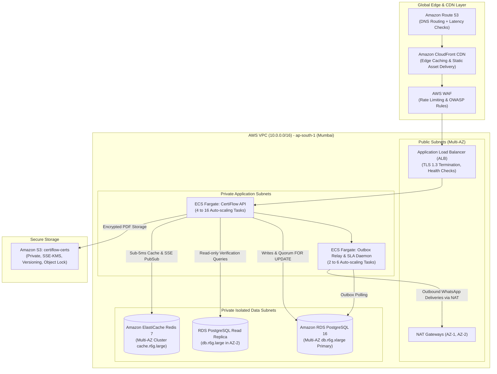

# CertiFlow: Production Deployment & Scaling Architecture

This document outlines the production architecture, capacity sizing, AWS Mumbai deployment topology, monthly infrastructure cost estimation, S3 access control policies, and operational disaster recovery playbooks for **CertiFlow**.

---

## 🎯 Production Workload Profile & Targets

The production deployment is engineered to support the following operational scale for the **Pragati Skills Mission**:
* **Registered Candidates:** 100,000+ skilling graduates across accredited training centres.
* **Daily Active Users (DAU):** 10,000 concurrent institutional users (Training Centres, District Officers, State Directorate, Employers).
* **Peak Issuance Throughput:** **30,000 certificates issued per hour** during statewide skill batch graduation cycles (8.3 certs/second sustained, 25 certs/second burst).
* **Verification Query Latency:** Sub-5ms response time for cached credentials; sub-50ms for cold lookups.

---

## ☁️ AWS Mumbai (`ap-south-1`) Infrastructure Topology



---

## 💰 Monthly AWS Mumbai Cost Breakdown (~$485–$620/Month)

The following estimate is computed using AWS Mumbai (`ap-south-1`) standard pricing for a high-availability, auto-scaling deployment capable of handling 100k users and 30k peak certs/hour:

| AWS Service | Instance / Tier Specification | High Availability & Sizing | Est. Monthly Cost (USD) |
| :--- | :--- | :--- | :--- |
| **Amazon ECS Fargate** | 4 to 16 vCPU tasks (2 vCPU, 4 GB RAM per task baseline) | Auto-scales dynamically on CPU and queue depth | **$110.00 – $145.00** |
| **Amazon RDS PostgreSQL** | `db.r6g.xlarge` (4 vCPU, 32 GB RAM, 250 GB gp3) | Multi-AZ Primary with automated failover | **$215.00 – $245.00** |
| **RDS Read Replica** | `db.r6g.large` (2 vCPU, 16 GB RAM, 100 GB gp3) | Dedicated reader for public verification queries | **$72.00 – $85.00** |
| **Amazon ElastiCache Redis** | `cache.r6g.large` (2 vCPU, 13 GB memory) | Multi-AZ Cluster with automatic failover | **$68.00 – $82.00** |
| **Amazon S3 & KMS** | Private S3 Standard with KMS Customer-Managed Key | ~100k PDFs (~15 GB storage) + 1.2M PUT/GET requests | **$12.00 – $18.00** |
| **Application Load Balancer** | AWS ALB + AWS WAF Essential Rules | 2 AZs, HTTP/2, SSL termination | **$24.00 – $32.00** |
| **CloudFront & Route 53** | Global edge distribution, 500 GB data transfer out | Free Tier edge compute + egress pricing | **$14.00 – $23.00** |
| **Total Estimated Monthly Budget** | | **Realistic Mumbai Production Footprint** | **$495.00 – $630.00** |

---

## 🔐 S3 Access Control & Security Policies

Certificates stored in S3 contain sensitive educational achievements. Under no circumstances is the bucket public. Access is governed by least-privilege IAM policies, KMS encryption, and ephemeral pre-signed URLs.

### 1. S3 Bucket Security Policy
```json
{
  "Version": "2012-10-17",
  "Statement": [
    {
      "Sid": "EnforceTLSRequestsOnly",
      "Effect": "Deny",
      "Principal": "*",
      "Action": "s3:*",
      "Resource": [
        "arn:aws:s3:::certiflow-production-certs",
        "arn:aws:s3:::certiflow-production-certs/*"
      ],
      "Condition": {
        "Bool": {
          "aws:SecureTransport": "false"
        }
      }
    },
    {
      "Sid": "DenyUnencryptedObjectUploads",
      "Effect": "Deny",
      "Principal": "*",
      "Action": "s3:PutObject",
      "Resource": "arn:aws:s3:::certiflow-production-certs/*",
      "Condition": {
        "StringNotEquals": {
          "s3:x-amz-server-side-encryption": "aws:kms"
        }
      }
    },
    {
      "Sid": "RestrictAccessToECSTaskRoleOnly",
      "Effect": "Allow",
      "Principal": {
        "AWS": "arn:aws:iam::123456789012:role/certiflow-ecs-task-execution-role"
      },
      "Action": [
        "s3:GetObject",
        "s3:PutObject",
        "s3:AbortMultipartUpload"
      ],
      "Resource": "arn:aws:s3:::certiflow-production-certs/*"
    }
  ]
}
```

### 2. Pre-Signed Download Strategy (Candidate Privacy)
* Public verifiers visiting `/verify/:certNo` are **never** provided an S3 direct link or pre-signed URL.
* Candidates receiving a WhatsApp message are provided a temporary URL containing a high-entropy secret download token:
  `https://certiflow.pragatiskills.gov.in/api/v1/public/certificates/download?token=<sha256-hex>`
* The backend verifies the token hash against `certificates.download_token_hash`, and streams the PDF buffer directly from S3 through an encrypted backend stream without exposing S3 URLs to client browsers.

---

## 🛠️ Production Failure Recovery Playbooks

### Playbook 1: WhatsApp Gateway Outage & Delivery Flakiness
* **Symptoms:**
  * Outbox Relay worker encounters repeated HTTP 502/504 errors from the WhatsApp Business Gateway.
  * WhatsApp delivery lag exceeds 5 minutes.
* **Automated Mitigation:**
  * The Outbox Relay worker automatically switches to exponential backoff (initial retry: 5s, doubling up to 15m).
  * Events exceeding 10 consecutive retry attempts transition to `status = 'FAILED'` in `outbox_events` and are moved to the Dead Letter Queue (DLQ).
* **Manual Operator Playbook:**
  1. Inspect the Outbox error log via CloudWatch Logs:
     ```bash
     aws logs filter-log-events --log-group-name /ecs/certiflow-workers --filter-pattern "OUTBOX_DELIVERY_FAILURE"
     ```
  2. Verify gateway status with provider (Meta / Twilio).
  3. Once upstream gateway recovers, trigger bulk replay of DLQ events using the administrative API:
     ```bash
     curl -X POST https://certiflow-api.pragatiskills.gov.in/api/v1/admin/outbox/replay \
       -H "Authorization: Bearer $STATE_DIRECTOR_TOKEN" \
       -H "Content-Type: application/json" -d '{"maxRetries": 10}'
     ```
  4. Deduplication is mathematically guaranteed because all retries send the idempotent header `X-Idempotency-Key: cert-{id}-v{ver}`. Zero candidates receive duplicate messages.

---

### Playbook 2: Redis Cluster Eviction & Cache Thrashing
* **Symptoms:**
  * ElastiCache Redis memory utilization exceeds 85%.
  * Client latency on public verification requests spikes from <5ms to >100ms.
* **Automated Mitigation:**
  * ElastiCache is configured with maxmemory policy `volatile-lru`. Transient verification cache keys (TTL: 1 hour) are evicted gracefully to safeguard Pub/Sub message channels.
* **Manual Operator Playbook:**
  1. Verify whether memory pressure is caused by cache buildup:
     ```bash
     aws elasticache describe-cache-clusters --cache-cluster-id certiflow-redis-cluster
     ```
  2. The CertiFlow application is engineered with an automatic database fallback: if a cache miss or Redis timeout occurs, it seamlessly queries the RDS PostgreSQL Read Replica directly.
  3. Scale up the Redis cluster node type dynamically from `cache.r6g.large` to `cache.r6g.xlarge` with zero downtime via AWS ElastiCache online resizing.

---

### Playbook 3: Concurrency Race & Split-Brain Quorum
* **Symptoms:**
  * Two District Officers (`Dev` and `Meera`) attempt to sign off on the same candidate batch at the exact same millisecond.
* **Built-in System Safeguards:**
  * **Pessimistic Row Locking:** `BatchService.recordDecision()` executes:
    ```sql
    SELECT * FROM "batches" WHERE "id" = $1 FOR UPDATE;
    ```
    The first officer's transaction acquires an exclusive lock on the batch row. The second transaction pauses until the lock is released.
  * **Composite Unique Constraint:** The persistence layer enforces:
    ```sql
    CONSTRAINT "batch_approvals_batch_id_officer_id_key" UNIQUE ("batch_id", "officer_id")
    ```
    If the same officer submits concurrent requests from two browser tabs, the second request is immediately rejected by PostgreSQL with code `P2002` (Unique constraint violation).
  * **Deterministic Error Handling:** The backend converts `P2002` into an HTTP 409 Conflict with the message: *"You have already recorded a decision for this batch review round."*
  * Quorum state machine increments cleanly without split-brain anomalies.
